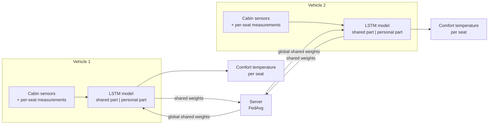

# PFL-TC: Personalised Federated Learning for Thermal Comfort in Software-Defined Vehicles

Code and data for the paper

> B. C. Gül, N. Devarakonda, N. Jazdi and M. Weyrich, "Personalized Comfort Features in Software-defined Vehicles Using Federated Learning," *2024 IEEE 29th International Conference on Emerging Technologies and Factory Automation (ETFA)*, 2024. [doi:10.1109/ETFA61755.2024.10710704](https://doi.org/10.1109/ETFA61755.2024.10710704)

PFL-TC predicts the cabin temperature at which each occupant feels comfortable,
from environmental sensors (ambient and cabin temperature, humidity, light) and
personal measurements per seat (skin temperature, local humidity). Models are
trained centrally or with federated learning across vehicles using
[Flower](https://flower.ai), so raw data stays in the car. Personalisation
follows FedPer: the environmental part of the network is shared between vehicles,
while the per-seat branches and the output layer stay in the vehicle.



## Contents

- [Quick start](#quick-start)
- [Data](#data)
- [Method](#method)
- [Results on the released data](#results-on-the-released-data)
- [Running with Flower](#running-with-flower)
- [Configuration](#configuration)
- [Differences from the experiments in the paper](#differences-from-the-experiments-in-the-paper)
- [Repository layout](#repository-layout)
- [Citation](#citation)

## Quick start

Python 3.11–3.13, CPU only.

```bash
git clone https://github.com/<your-org>/pfl-tc.git
cd pfl-tc
python -m venv .venv && source .venv/bin/activate
pip install -e ".[dev]"

pytest -q                                                   # about 30 s
pfltc train --variant personalized_model --regime fedper    # one model, about 20 s
pfltc experiments                                           # full comparison, about 15 min on 2 CPU cores
python scripts/make_figures.py                              # figures in results/figures/
```

`pfltc train` prints the test metrics as JSON. `pfltc experiments` writes
`results/runs.csv` (one row per run), `results/summary.md` (mean ± s.d. over
seeds), the resolved configuration, the package versions, and the predictions and
training history of every run.

## Data

[`data/cabin_comfort.csv`](data/cabin_comfort.csv) holds 2,115 sensor readings
(one every ~3.7 s) from one car driven on two days in January 2024: four drives,
three drivers, up to four occupants. The column dictionary and known issues are
in [`data/README.md`](data/README.md).

**Prediction target.** The paper predicts the HVAC set temperature. The set-point
log is not part of this release, so by default the code predicts each occupant's
*neutral temperature*, derived from their thermal-sensation vote with Griffiths'
method:

$$T_\mathrm{n} = T_\mathrm{cabin} - \frac{\text{vote}}{G}, \qquad G = 0.5\ \mathrm{K}^{-1}$$

A vote of −1 ("slightly cool") at a cabin temperature of 21 °C gives 23 °C.
Because the target is computed from the votes, the votes are never used as model
inputs; the configuration refuses that combination. If you have set-point logs,
add them as columns and set

```yaml
target:
  mode: column
  columns: [z1_set_temp_c, z2_set_temp_c]
```

## Method

### Model configurations (Fig. 3 of the paper)

| Configuration | Inputs | Network |
|---|---|---|
| Basic baseline | ambient temperature, cabin temperature, cabin RH, light (solar-load proxy) | LSTM(50) → Dense |
| Personalised baseline | basic inputs + skin temperature and RH of zone 1 (driver) and zone 2 (front passenger), concatenated | LSTM(50) → Dense |
| Personalised model | the same inputs, one branch per group | LSTM(10) for the environment and LSTM(20) per zone → concatenate → Dense |

Every model predicts one value per seat (driver and front passenger). Training uses
Adam (learning rate 10⁻³), mean squared error and batch size 32.

### Training regimes

| Regime | Shared between vehicles | Schedule |
|---|---|---|
| Centralised | all data pooled on one server | up to 100 epochs, early stopping on validation loss (patience 20) |
| Local only | nothing | each vehicle trains alone, 10 rounds × 10 epochs |
| FedAvg | all weights | 10 rounds × 10 local epochs, average weighted by the number of local samples (Eq. 1 of the paper) |
| FedPer | the environmental layers | as FedAvg, but the zone branches and the output layer stay in the vehicle ([Arivazhagan et al., 2019](https://arxiv.org/abs/1912.00818)) |

The federated clients are the two recording days (`federated.partition: by_day`):
two vehicles with different conditions, an evening drive without daylight and an
afternoon drive with sun. One client per drive (`by_drive`) and a random even split
as in the paper (`iid`) are also available.

### Evaluation protocol

* **Chronological split per drive**: first 70 % for training, next 15 % for
  validation, last 15 % for testing. Readings are 3.7 s apart and nearly identical
  to their neighbours, so a random split would place near-copies of test samples
  in the training set.
* **The test split is used once.** The epoch (centralised) or round (federated)
  with the lowest validation loss is kept, and the window length and learning rate
  were chosen on the validation split
  (`pfltc tune`, tables in [`results/tuning/`](results/tuning)).
* **Fixed normalisation constants** for every client (`normalization` in the
  configuration), so no data statistics leave a vehicle and centralised and
  federated models see identical inputs.
* **Metrics in °C**: MSE, RMSE, MAE, MAPE and R², computed after undoing the
  normalisation.
* **Five seeds** per configuration; tables give the mean ± standard deviation.
* **Two reference predictors without learning**: the mean of the training targets,
  and the current cabin temperature (i.e. assume that everybody is thermally neutral).

## Results on the released data

Test split, derived neutral-temperature target, mean ± s.d. over five seeds
(the reference predictors are deterministic). The full table with MSE, MAPE and
training time is in [`results/summary.md`](results/summary.md); every run is in
[`results/runs.csv`](results/runs.csv).

| Configuration | Regime | MAE (K) | RMSE (K) | R² |
|---|---|---|---|---|
| Basic baseline | Centralised | 0.85 ± 0.02 | 1.09 ± 0.03 | 0.20 ± 0.04 |
| Basic baseline | Local only | 1.17 ± 0.03 | 1.57 ± 0.03 | −0.60 ± 0.05 |
| Basic baseline | FedAvg | 0.82 ± 0.01 | 1.04 ± 0.02 | 0.25 ± 0.03 |
| Basic baseline | FedPer | 0.93 ± 0.05 | 1.27 ± 0.07 | −0.08 ± 0.10 |
| Personalised baseline | Centralised | 1.12 ± 0.07 | 1.47 ± 0.07 | −0.42 ± 0.16 |
| Personalised baseline | Local only | 1.00 ± 0.04 | 1.24 ± 0.03 | −0.03 ± 0.06 |
| Personalised baseline | FedAvg | 1.16 ± 0.07 | 1.53 ± 0.09 | −0.52 ± 0.19 |
| Personalised baseline | FedPer | 1.13 ± 0.07 | 1.45 ± 0.08 | −0.36 ± 0.15 |
| Personalised model | Centralised | 0.93 ± 0.02 | 1.20 ± 0.01 | 0.01 ± 0.02 |
| Personalised model | Local only | 0.93 ± 0.04 | 1.16 ± 0.04 | 0.10 ± 0.05 |
| Personalised model | FedAvg | 0.90 ± 0.12 | 1.18 ± 0.17 | 0.05 ± 0.26 |
| Personalised model | FedPer | 0.94 ± 0.04 | 1.20 ± 0.03 | 0.04 ± 0.04 |
| Reference | predict the training mean | 1.02 | 1.34 | −0.21 |
| Reference | predict the cabin temperature | 1.15 | 1.28 | −0.18 |


What the numbers show:

* **Federated training matches centralised training** without pooling any data:
  the basic baseline reaches 0.82 ± 0.01 K MAE with FedAvg and 0.85 ± 0.02 K centrally.
* For the basic baseline, **training each vehicle only on its own data is clearly
  worse** (1.17 K MAE); federation closes that gap.
* **On this data the per-seat inputs do not help.** Every personalised configuration
  has a higher error than the basic baseline trained centrally or with FedAvg, and
  FedPer does not consistently improve on FedAvg. Skin temperatures drift during a
  drive, so in most drives the test part lies largely outside the range seen in
  training (for example, all of the driver's test readings in drive 3).
* The best models explain a fifth to a quarter of the variance (R² 0.20–0.25). With two
  recording days and about 40 changes of the comfort votes, the test split contains
  few distinct target values.

These numbers check that the pipeline works end-to-end on the public data. They use
the derived target and are therefore **not comparable with Table II of the paper**,
which was computed on recorded set temperatures. More drives, occupants and recorded
set points are needed before drawing conclusions about personalisation.


## Running with Flower

The experiments above use an in-process simulation of FedAvg
([`src/pfltc/train.py`](src/pfltc/train.py)), which is deterministic and needs no
extra processes. The same client logic is packaged as a Flower App
([`src/pfltc/fl/`](src/pfltc/fl)) for real deployments, for example one Raspberry Pi
per vehicle. Both share the model, the seeding and the FedPer state handling: for the
same seed and schedule they produce the same training and validation losses in
every round (checked to eight decimal places for three rounds of FedPer, in local
simulation and with a SuperLink and two SuperNodes).

### Local simulation

```bash
pip install -e ".[simulation]"
# Use the current environment instead of letting Flower build a new one (with
# TensorFlow) for every run. Set it before the first `flwr run`, which starts
# the local SuperLink in the background.
export FLWR_DISABLE_RUNTIME_DEPENDENCY_INSTALLATION=1
flwr run . --stream --run-config "data-path='$PWD/data/cabin_comfort.csv'"
```

Flower starts a local SuperLink with two simulated SuperNodes, one per recording
day. The run-config keys are defined in `[tool.flwr.app.config]` of
[`pyproject.toml`](pyproject.toml): `num-server-rounds`, `local-epochs`, `variant`,
`strategy` (`fedavg` or `fedper`), `seed`, `num-clients`, `data-path`,
`config-file` and `output-dir`. Every round logs the clients' validation and test
metrics; with `output-dir` set, the final shared weights and the metric history
are saved there. Unlike `pfltc train`, the Flower app keeps the last round rather
than the round with the lowest validation loss.

One client per drive:

```bash
flwr run . --stream --federation-config "num_supernodes=4" \
  --run-config "data-path='$PWD/data/cabin_comfort.csv' config-file='$PWD/configs/four_clients.yaml' num-clients=4"
```

### Deployment, one SuperNode per vehicle

Install this package on the server and on every vehicle computer (for example a
Raspberry Pi), then:

```bash
# Server
flower-superlink --insecure --host 0.0.0.0

# Vehicle k (k = 0, 1); each SuperNode reads the CSV and keeps only its own partition
flower-supernode --insecure --superlink <server-ip>:8000 --node-config "partition-id=k num-partitions=2"
```

Register the SuperLink in `~/.flwr/config.toml` on your workstation and start the run:

```toml
[superlink.vehicles]
address = "<server-ip>:8000"
insecure = true
```

```bash
flwr run . vehicles --stream --run-config "data-path='/absolute/path/on/the/vehicles/cabin_comfort.csv'"
```

`--insecure` disables TLS and node authentication; use it only in a closed test
network (see the [Flower documentation](https://flower.ai/docs/framework/) for TLS
and SuperNode authentication).

## Configuration

All settings live in [`src/pfltc/default.yaml`](src/pfltc/default.yaml). Every
command accepts `--config my.yaml` (merged onto the defaults) and repeated
`--set key.subkey=value` overrides:

```bash
pfltc train --variant basic --regime fedavg --set federated.partition=iid --set federated.rounds=30
pfltc experiments --config configs/four_clients.yaml
pfltc tune --variant personalized_model --set split.min_context=29 \
           --grid windows.seq_len=1,5,10,20,30 --grid model.learning_rate=0.001,0.003
```

| Key | Default | Meaning |
|---|---|---|
| `target.mode` | `griffiths` | `griffiths` (neutral temperature from the votes) or `column` (recorded target columns) |
| `target.zones` | `["1", "2"]` | seats to predict: `1` driver, `2` front passenger, `3l`/`3r` rear |
| `features.basic`, `features.zone` | see file | input columns; zone columns get the `z<k>_` prefix |
| `windows.seq_len` | `1` | samples per LSTM input window |
| `split.mode` | `chronological` | or `random` (not recommended, see above) |
| `federated.partition` | `by_day` | `by_day`, `by_drive` or `iid` |
| `federated.rounds`, `federated.local_epochs` | 10, 10 | FL schedule |
| `experiment.seeds` | 0–4 | seeds used by `pfltc experiments` |

## Differences from the experiments in the paper

This repository is a cleaned-up re-implementation. Where it deviates from the
setup described in the paper, it does so for the reasons below.

| Aspect | Paper | This repository |
|---|---|---|
| Target | recorded HVAC set temperature | neutral temperature derived from the comfort votes (the set-point log is not in the released data); recorded targets are supported with `target.mode: column` |
| Inputs | includes clo, MET and PMV per zone | clo and MET are constant in the released data and are left out; the votes (PMV) are not inputs because the target is derived from them |
| Data split | not specified | chronological per drive with validation split; a random split is available as an option |
| Model selection | not specified | best epoch / round on the validation split; window length and learning rate tuned on validation |
| Metrics | MSE, MAE, MAPE | the same, plus RMSE and R², all in °C on the original scale |
| Clients | data distributed evenly over 2 clients | one client per recording day (non-IID); the even random split is available (`iid`) |
| Personalisation | zone-wise LSTM branches | zone-wise LSTM branches, kept local with FedPer |
| Repetitions | single run | 5 seeds, mean ± s.d. |

## Repository layout

```
pfl-tc/
├── configs/                example configurations (4 clients, recorded set temperatures)
├── data/                   released recordings + data dictionary
├── src/pfltc/
│   ├── default.yaml        all settings
│   ├── data.py             loading, cleaning, targets, windows, splits, client partitions
│   ├── models.py           the three LSTM configurations, named weights for aggregation
│   ├── train.py            centralised, local, FedAvg and FedPer training
│   ├── metrics.py          metrics in °C
│   ├── cli.py              `pfltc train | experiments | tune`
│   └── fl/                 Flower ServerApp and ClientApp
├── scripts/
│   ├── prepare_data.py     raw Excel export -> anonymised CSV
│   └── make_figures.py     figures for this README
├── results/                summary tables, tuning tables and figures of the runs below
└── tests/                  pytest suite
```

## Citation

```bibtex
@inproceedings{guel2024pfltc,
  author    = {G{\"u}l, Baran Can and Devarakonda, Neeharika and Jazdi, Nasser and Weyrich, Michael},
  title     = {Personalized Comfort Features in Software-defined Vehicles Using Federated Learning},
  booktitle = {2024 IEEE 29th International Conference on Emerging Technologies and Factory Automation (ETFA)},
  year      = {2024},
  doi       = {10.1109/ETFA61755.2024.10710704}
}
```

## Licence and acknowledgement

The code is released under the [MIT licence](LICENSE). The recordings in `data/`
are released under [CC BY 4.0](https://creativecommons.org/licenses/by/4.0/).

This work was carried out in the project *Software-Defined Car (SofDCar)*, funded
by the German Federal Ministry for Economic Affairs and Climate Action (BMWK).
